# Shinkou Pixel

Shinkou Pixel 是一款基于 Tauri 的图片转像素画桌面应用，主要面向动漫、卡通和插画，也提供适用于照片的采样模式。应用支持可配置的色板、轮廓处理和过渡色保留，帮助生成边界清晰、色块统一的像素图像。

所有图像处理均在本机完成。当前主要支持 Windows。

## 效果示例

示例原图为项目内置的 AI 生成演示素材，像素结果由当前程序直接计算，未进行人工修图。对比图中的结果使用最近邻整数倍放大展示，原图仅作缩放预览。

### 插画转换

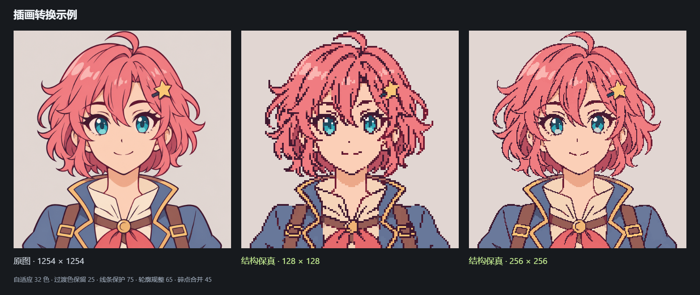

结构保真模式，自适应 32 色；过渡色保留 25、线条保护 75、轮廓规整 65、碎点合并 45。两种输出尺寸使用相同的其余参数。

[示例原图](public/illustration.png) · [128 × 128 原尺寸结果](docs/images/illustration-128.png) · [256 × 256 原尺寸结果](docs/images/illustration-256.png)

### 过渡色保留

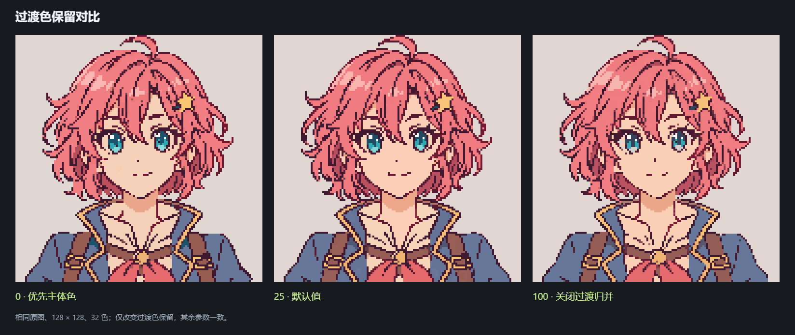

相同原图、128 × 128、自适应 32 色，仅改变过渡色保留。0 更偏向主体色，25 为默认值，100 关闭过渡归并；这项设置不改变总色数上限。

[保留量 0](docs/images/illustration-retention-0.png) · [保留量 25](docs/images/illustration-128.png) · [保留量 100](docs/images/illustration-retention-100.png)

### 风景转换

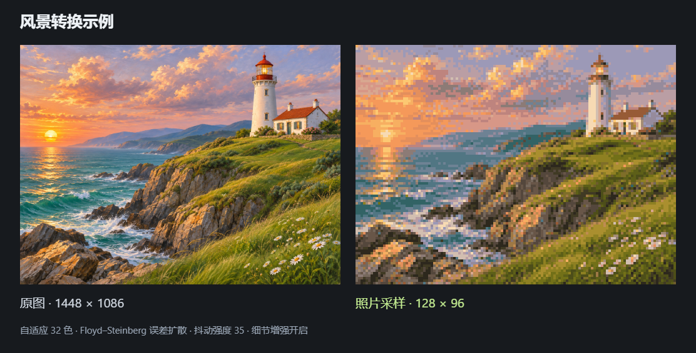

照片采样模式，128 × 96、自适应 32 色；使用 Floyd–Steinberg 误差扩散，抖动强度 35，开启细节增强。

[示例原图](public/lighthouse.png) · [128 × 96 原尺寸结果](docs/images/landscape-128.png)

所有示例的完整参数与输入文件校验值见 [示例清单](docs/examples.json)。

### SLIC 区域净化

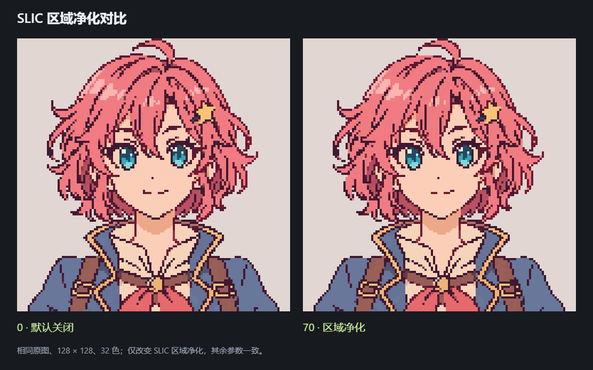

相同原图、128 × 128、自适应 32 色，仅将 SLIC 区域净化从 0 调整为 70。该实验选项用于合并低对比碎色，默认关闭；它不会普遍改善所有图像，也可能简化薄阴影。

[默认结果](docs/images/illustration-128.png) · [区域净化 70](docs/images/illustration-slic-70.png)

### 本地 AI 线条辅助

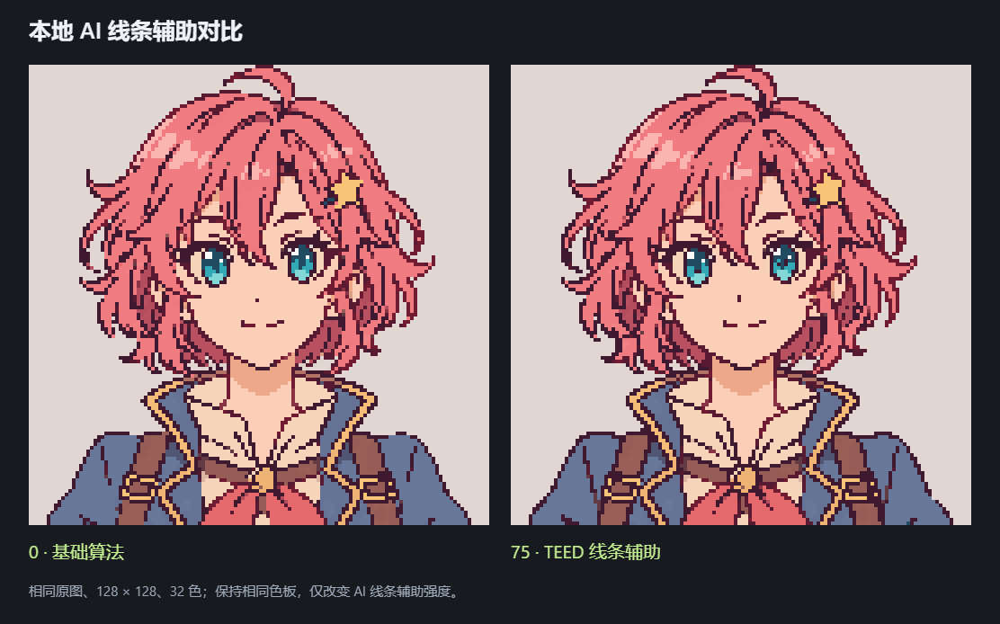

相同原图、128 × 128、同一份自适应 32 色色板，仅将 AI 线条辅助从 0 调整为 75。预训练 TEED 网络提供边缘响应，原有算法负责网格和色彩约束，未进行生成式重绘。不同素材的效果可能不同，该选项默认关闭。

[AI 75 原尺寸结果](docs/images/illustration-ai-75.png) · [真实网络线稿响应](docs/images/illustration-ai-edges.png) · [模型来源与实现说明](docs/ai-pipeline.md)

### 低像素重构

0.9.0 在 32、48、64 px 下加入离散主色投票、相近色簇归并与连续结构线筛选，减少区域均值造成的中间色和浅边。本地 HRNetV2 网络定位正面动漫五官，再从原图测量虹膜、眼睑和闭口嘴线，在真实小网格上安排颜色与位置；卡通动物等不适用的素材使用通用色块与短笔画处理。

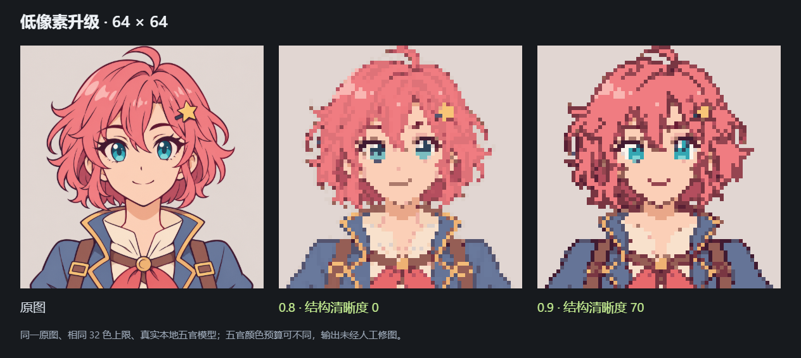

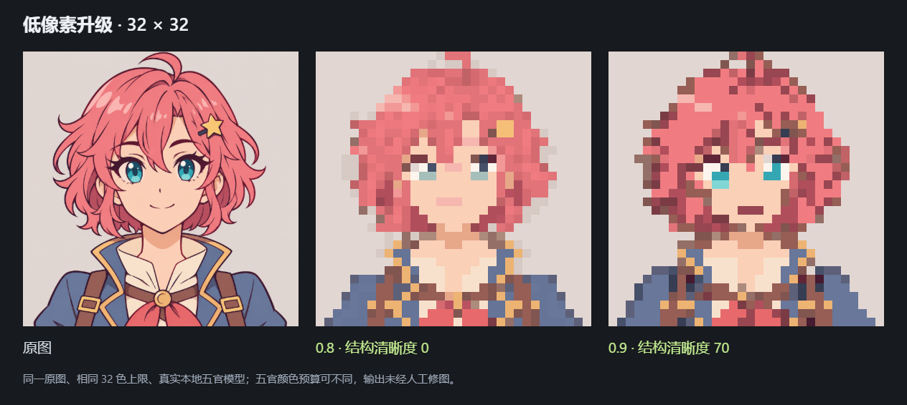

同一张内置原图、相同 32 色上限；0.9 使用默认结构清晰度 70、描边保留 55、细节补偿 75、五官保真 75。结果未经人工修图，64 px 放大 6 倍、32 px 放大 12 倍展示。可以在色数上限内为原图真实高光和虹膜重新分配颜色，因此两个版本的具体色板可能不同。结构清晰度设为 0 时保留 0.8 的处理。

[48 px 升级对比](docs/images/low-resolution-upgrade-48.png) · [32 px 原尺寸](docs/images/illustration-reconstruct-32.png) · [48 px 原尺寸](docs/images/illustration-reconstruct-48.png) · [64 px 原尺寸](docs/images/illustration-reconstruct-64.png)

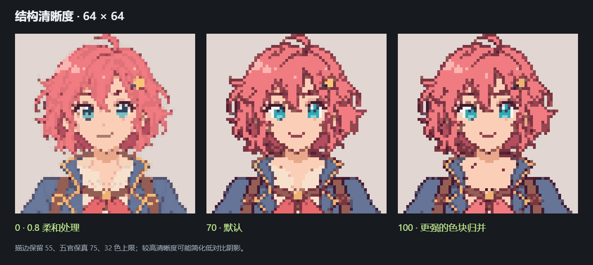

### 描边与五官的独立控制

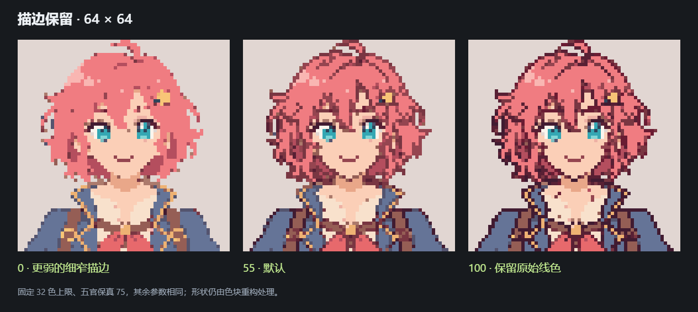

**结构清晰度**控制主色色簇、连续结构线及五官占格重建，0 回到原有柔和处理。**描边保留**独立控制细窄深色线的弱化程度；100 关闭该弱化，但仍使用色块重构。**细节补偿**用于平坦区域内有依据的短小笔画。**五官保真**控制神经定位辅助，0 可关闭。也可将“小尺寸处理”切回“线稿保真”，使用原有流水线。

[32 px 五官辅助开关对比](docs/images/semantic-detail-comparison.png) · [算法公式与模型说明](docs/low-resolution-pipeline.md) · [视觉目标研究](design/low-resolution-targets-2026-11-06/README.md) · [前期方案研究](docs/low-resolution-study.md)

此功能是神经五官定位与几何重构的混合方案，未训练像素画生成模型。极小五官、侧脸、遮挡和复杂画面仍需要取舍；它不保证所有输入都优于原有处理。96 px 及以上继续使用原有流水线。

### 本地生成式重绘（实验）

对于 16–32 px 等极低分辨率，可以使用独立的 **AI 辅助重绘**：通过 FLUX.2 Klein 4B 图像编辑模型参考原图，重新组织五官、发束和色块，再约束到真实目标网格与指定色板。面板并排展示原图、同尺寸算法结果与候选网格，支持多候选比较、取样偏移和原尺寸导出。生成结果由用户选择后应用，原图始终保留。

此路径需要另外安装本机 ComfyUI 与约 12.5 GB 模型，不随桌面安装包分发。8 GB 显卡使用 FP8 扩散权重与 CPU 卸载；普通像素转换不依赖生成服务。生成可能改变角色特征，模型输出的大图也不保证严格像素对齐，因此仍需检查落格后的结果。

**0.10.1 增加原图配色约束，默认保留 100%。** 自适应色板下，最终网格使用原图提取的色板，减少模型把粉色改成深红、整体过饱和的问题；0 保留模型原色，中间值允许逐步调整，无需重新生成。固定风格色板仍使用选定的颜色集合。

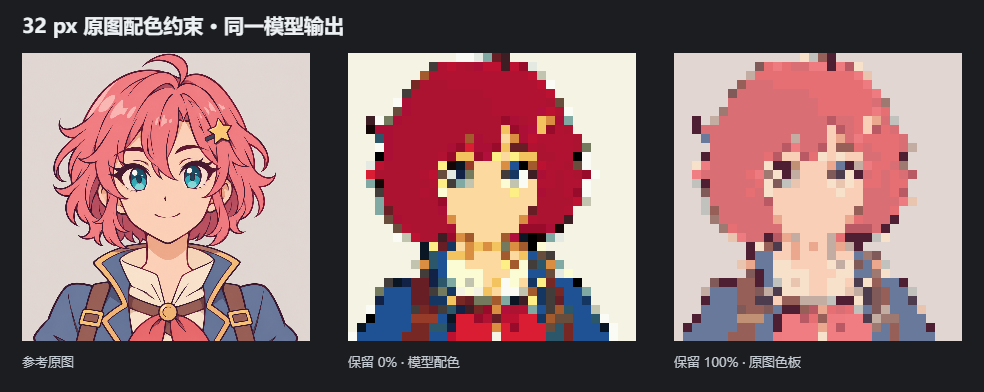

上图使用同一份模型输出，仅改变配色约束，未重新生图或人工修图。[16 px 配色对比](docs/images/redraw-colors-16.png) · [32 px 校色后原尺寸](docs/images/redraw-source-colors-32.png) · [色板与校验值](docs/redraw-colors-example.json)。此约束不恢复已经丢失的嘴线或其他结构，也不保证所有部位的颜色语义对应正确。

以下两组结构测试保留模型原始配色，等同于将“原图配色保留”设为 0，可与默认约束效果分别比较。

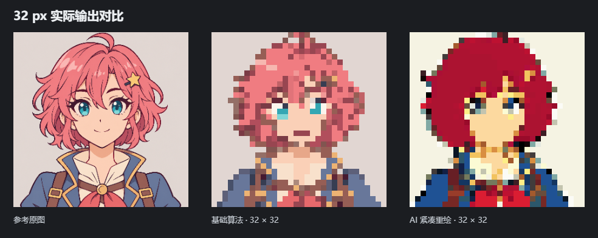

同一张内置原图、32 色上限。右侧为紧凑模式生成的 128 × 128 候选，再落格为真实 32 × 32；种子 314159、取样偏移 0，未经人工修图。该例色块更集中，但出现发色偏移和嘴线丢失，因此本功能标为实验选项，当前不能保证在 16–32 px 下稳定优于原有算法。可切换“紧凑重绘”和“大图重绘”，生成多张候选后自行比较。

[生成原图 128 × 128](docs/images/redraw-generated-128.png) · [真实 32 × 32 候选](docs/images/redraw-grid-32.png) · [完整提示与参数](docs/redraw-example.json)

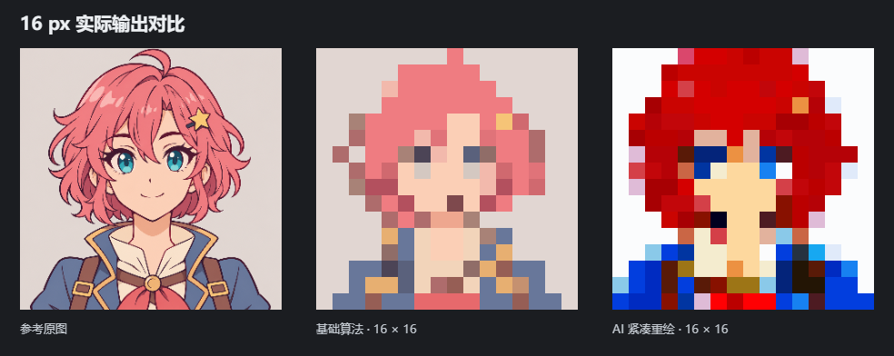

16 px 同参数测试中，生成候选仍有可辨认的蓝色眼睛和较集中的色块，但配色与神态发生变化，嘴部也不稳定。右侧由模型实际生成 64 × 64 后落格得到，未经人工修图；两侧基础与生成结果均为同一版本程序的真实输出。

[16 × 16 原尺寸](docs/images/redraw-grid-16.png) · [64 × 64 生成原图](docs/images/redraw-generated-64.png) · [16 px 参数](docs/redraw-example-16.json)

[本地安装、使用方法与算法公式](docs/generative-redraw.md) · [固定模型下载清单](scripts/generation-models.json)

## 功能概览

| 功能 | 说明 |
| --- | --- |
| 图像导入 | 原生文件选择与拖放导入，支持 PNG、JPEG、WebP、BMP、GIF、AVIF |
| 转换模式 | 结构保真、照片采样 |
| 计算设备 | WebGPU 硬件加速、自动选择与 CPU 兼容模式；失败时自动回退 |
| 像素尺寸 | 按长边设置 16–512 px，保持原图宽高比；极低分辨率可尝试生成式重绘 |
| 色板 | 自适应 4–256 色，以及 PICO-8、Game Boy、柔和暮色固定色板 |
| 边缘处理 | 线条保护、轮廓规整、过渡色保留、碎点合并 |
| 区域净化 | 可选 SLIC 超像素分区与主色归并，默认关闭 |
| AI 结构辅助 | 本地 TEED 神经网络边缘分析、可调保护强度与独立线稿预览，默认关闭 |
| 低像素重构 | 32–64 px 下的离散主色投票、色簇归并与连续结构线筛选；清晰度可调，可回到 0.8 处理 |
| AI 五官辅助 | 本地 HRNetV2 定位，测量原图虹膜、高光与嘴线并重建五官占格；GPU / CPU 推理及自动回退 |
| AI 辅助重绘 | 可选本地 FLUX.2 Klein 4B 图像编辑，16–64 px 候选比较、真实网格与可调原图配色约束，需独立生成服务 |
| 色彩调整 | 亮度、对比度、饱和度；照片采样模式另提供细节增强与抖动 |
| 预览 | 原图与结果切换、滑动对比、缩放、平移、像素网格 |
| 网格取色 | 直接读取结果像素的 HEX、RGB、透明度与行列位置，支持复制 HEX / RGBA |
| 操作历史 | 参数撤销、重做与恢复默认设置 |
| 图像导出 | PNG、WebP，支持 1x、2x、4x、8x 最近邻放大 |
| 色板导出 | GPL 色板文件与 HEX 色值复制 |

## 使用方法

1. 点击 **导入图片**，或将图片拖入窗口。
2. 根据素材选择 **结构保真** 或 **照片采样**。
3. 设置像素尺寸与颜色数量，确定画面的细节密度和色板范围。
4. 调整边缘与色彩参数，通过原图对比检查轮廓、五官和浅色线条。
5. 选择输出格式与放大倍率，点击 **导出作品** 保存结果。

动漫、卡通和插画可从 **128–256 px、16–32 色** 开始调整。需要更明显的颗粒感时降低像素尺寸；需要保留更多细节时提高像素尺寸。

### 转换模式

**结构保真**

在最终缩小前分析细线与颜色区域，再将区域映射到像素网格。该模式提供独立的过渡色和轮廓控制，适合轮廓明确、平涂色块较多的图像，不使用抖动。

**照片采样**

采用线性光面积采样与感知颜色量化，适合照片、风景和连续明暗变化较多的图像。可启用细节增强，以及 Bayer 有序抖动或 Floyd–Steinberg 误差扩散。

### 结构保真参数

| 参数 | 默认值 | 调整效果 |
| --- | --- | --- |
| 过渡色保留 | 25 | 低值优先将识别出的边缘混色归入两侧主色；高值保留更多过渡层次 |
| 线条保护 | 75 | 提高细线在网格映射中的优先级；数值过高可能加粗部分纹理 |
| 轮廓规整 | 65 | 减少突出单格与不规则边界；设为 0 可关闭此项处理 |
| 碎点合并 | 45 | 合并周围颜色高度一致、缺少细节支持的低对比孤立点 |
| SLIC 区域净化 | 0 | 实验选项；按颜色与位置分区，将受支持的低对比碎色归入已有区域主色，增加 CPU 耗时 |
| AI 线条辅助 | 0 | 本地网络预测边缘，只增强获得原图细线证据支持的保护权重；高值可能加粗纹理 |

**过渡色保留、颜色数量与轮廓规整分别控制不同的处理环节：**

- **过渡色保留**控制识别出的边缘混色如何归属。0 表示最强归并，100 关闭该阶段的过渡归并。
- **颜色数量**控制自适应色板的总色数。固定色板使用预设颜色数量。
- **轮廓规整**控制相邻格子构成的边界形状。

过渡色保留是处理强度，不代表保留原图颜色的百分比。0 不会删除所有灰色或阴影，100 也不会取消颜色量化与像素尺寸限制。降低保留量后，建议检查嘴线、高光和浅色描边；细节被简化时可适当提高数值。

### 网格取色

1. 点击预览工具栏的 **网格取色**（吸管图标）。应用切换到像素结果，并开启网格显示；网格线在单格显示尺寸至少为 4 px 时出现。
2. 点击一个像素格，底部显示该格的 HEX、RGB、行列位置，并框选当前格。行列从 1 开始计数。
3. 点击 **复制 HEX** 或 **复制 RGBA**。透明格显示“透明”，可复制 RGBA；不将其作为不透明黑色复制。

方向键可移动选中格，`Enter` 复制 HEX，`Esc` 退出。取色模式中按住 `Shift` 拖动可平移放大的画布。切换原图或对比模式会退出取色，避免读取遮罩上的颜色。

色值直接来自转换结果数组，缩放、网格线与选框不会参与采样，也不会修改导出图像。重新转换或替换图片后清除旧取色结果。若系统阻止剪贴板访问，仍可选中读数手动复制。

### 使用 AI 线条辅助

在结构保真模式中调高 **AI 线条辅助**，等待“模型已就绪”。工具栏的 **AI 线稿预览**（脑形图标）可查看网络分析到的边缘；再次点击或切回像素预览即可检查最终结果。取色与导出始终读取最终像素结果。

模型和推理引擎随程序提供，图片不上传，运行时不需要网络、Python、CUDA 或密钥。自动/GPU 模式优先尝试 WebGPU 推理，CPU 模式使用 WebAssembly；GPU 推理失败时尝试 CPU。模型不可用时会明确显示“AI 未生效”，并保留基础算法转换能力。

第一次使用需要初始化运行时和模型。对同一张原图调节强度或像素参数会复用网络分析。风格缩略图显示基础算法的风格参考；主预览与导出共享本次完整处理结果。

TEED 提供通用边缘响应，当前不进行人物部件语义分类或生成式修图。它可能强化纹理或漏掉细节，不能保证任意图像都优于基础算法。模型来源、许可、输入格式和约束见 [本地 AI 线条辅助](docs/ai-pipeline.md)。

### 使用生成式重绘

点击顶部 **AI 辅助重绘**，选择 16–64 px 目标网格，生成并比较候选后再应用。此功能通过独立的本机 ComfyUI 服务运行，需要额外安装 Python、CUDA PyTorch 与模型；与上述随程序提供的线条辅助使用不同的运行环境。首次配置与完整流程见 [本地生成式重绘](docs/generative-redraw.md)。

### 导出

- **PNG**：无损 RGBA，适合需要精确颜色或透明背景的作品。
- **WebP**：使用高质量编码，适合更小的文件体积；需要严格无损时使用 PNG。
- **放大倍率**：使用最近邻整数倍放大，保留像素边缘，不引入平滑插值。
- **透明度**：启用时输出二值透明度；关闭时以白色背景合成。

预览与导出使用同一份处理结果。输出宽高为像素画宽高乘以所选放大倍率。

### GPU 加速

在 **计算设备** 中选择运行方式：

| 选项 | 行为 |
| --- | --- |
| 自动 | 结构保真且输入不少于 65,536 像素时尝试 GPU；小图和照片采样使用 CPU，以避免传输开销 |
| GPU | 两种转换模式均尝试 WebGPU 硬件计算；初始化、缓冲区或设备错误时自动重新运行完整 CPU 流程 |
| CPU | 所有算法阶段使用 CPU，不申请 GPU 设备 |

底部状态栏显示实际使用的 **GPU 混合**、**CPU** 或 **CPU · 已回退**。悬停可查看适配器、GPU 计算阶段或回退原因。预览与导出共享本次结果，不在导出时另行切换算法。

GPU 后端在处理 Worker 内使用 WGSL 计算着色器。并行阶段与顺序阶段的分工如下：

| 阶段 | GPU 模式中的执行位置 |
| --- | --- |
| 线性光面积采样、透明度合成 | GPU |
| 亮度、对比度、饱和度与照片细节增强 | GPU |
| 细线响应、邻域支持度、区域一致性分析 | GPU（结构保真模式） |
| Oklab 最近色匹配、Bayer 有序抖动 | GPU |
| 自适应色板提取与两轮聚类优化 | CPU |
| 局部过渡归并、区域映射、轮廓规整、碎点合并 | CPU |
| SLIC 分区与区域净化（开启时） | CPU |
| TEED 神经网络（开启时） | 独立 ONNX Runtime WebGPU / CPU 推理，与图像算法后端分别显示状态 |
| Floyd–Steinberg 蛇形误差扩散 | CPU；之前的采样和调整仍可使用 GPU |
| 风格预设缩略图 | 独立 CPU Worker，避免与主预览争用 GPU |

需要运行时提供 WebGPU、硬件适配器和可用的显卡驱动。应用通过 WebView2 使用系统提供的能力，无须安装 CUDA 或下载模型；不将软件适配器计为 GPU 加速。`high-performance` 是设备选择偏好，具体适配器由运行时及系统决定，不保证选择独立显卡。WebGPU 能力说明见 [WebGPU 规范](https://www.w3.org/TR/webgpu/)，运行时要求见 [Tauri WebView 版本说明](https://v2.tauri.app/reference/webview-versions/)。

首次执行需要初始化设备和编译着色器；后续参数调整复用设备、计算管线和原图上传缓冲区。数据传输、显卡性能及 CPU 阶段的占比都会影响整体速度，小任务不一定更快。CPU 使用 JavaScript 数值计算，GPU 使用 `f32`；两者采用相同规则，但临界阈值或最近色距离接近时，可能出现少量像素差异，不保证所有输入逐字节相同。

#### 可复现性能检查

`npm run test:gpu` 会要求真实硬件适配器，检查采样与透明度、特征精度、三种量化路径、完整转换结果、CPU 回退和 Worker 请求队列，并输出整条流水线的耗时。设备不可用时该硬件检查会失败，普通 `npm test` 仍可在无 GPU 环境运行。

以下为 Windows / Microsoft Edge、WebGPU `intel gen-12lp` 硬件适配器的一次本机实测。输入为内置的 1254 × 1254 插画，使用默认结构保真参数、自适应 32 色，AI 与 SLIC 均关闭；每种尺寸分别预热一次后取三次完整转换的中位数，包含上传、回读与 CPU 阶段，不包含首次设备初始化。

| 输出长边 | CPU | GPU 混合 | 整体加速 |
| --- | ---: | ---: | ---: |
| 128 px | 1185 ms | 509 ms | 2.33× |
| 256 px | 1781 ms | 975 ms | 1.83× |
| 512 px | 2147 ms | 1386 ms | 1.55× |

这三组输出与 CPU 参考结果逐字节一致。表格是该机器和样例的结果，其他设备、运行时与图像可能不同；可运行上述脚本取得当前环境的数据。

### 快捷键

| 操作 | 快捷键 |
| --- | --- |
| 导入图片 | `Ctrl+O` |
| 导出作品 | `Ctrl+S` |
| 撤销 | `Ctrl+Z` |
| 重做 | `Ctrl+Shift+Z` 或 `Ctrl+Y` |
| 缩放画布 | `Ctrl+滚轮` |
| 平移画布 | 放大后拖动画布 |

## 处理范围与限制

- 单张图片最大 60 MB。GIF 读取首帧。
- 工作图像最长边限制为 4096 px，总像素数不超过 1200 万；超出限制的图片会先缩小，界面仍显示原图尺寸。
- 结构分析图最长边限制为 2048 px。算法在独立 Web Worker 中运行。
- 小于目标像素尺寸的图片不会先放大处理。
- 基础模式采用图像处理规则，可选预训练网络提供边缘辅助；不进行生成式重绘。较低的网格分辨率会简化细节，像素阶梯仍然存在。
- 生成式重绘是独立实验选项，可能改变角色细节；透明输入先合成白底。候选必须检查真实小网格，不能仅依据放大的生成原图判断质量。
- 几何规则不能完全区分抗锯齿过渡与真实的薄阴影、浅色线条。不同素材需要分别调整参数。

算法实现与设计说明见 [结构保真处理流程](design/structure-pipeline.md)。

## 算法与公式

以下为当前基础流水线使用的规则。0.7.0 另提供可选的 TEED 神经网络边缘辅助；它增加结构保护权重，不生成颜色或重绘原图。CPU 与 GPU 共用图像流水线和参数，GPU 替换其中可独立并行的阶段。实现入口为 [pixelate.ts](src/engine/pixelate.ts)，GPU 内核为 [gpu.wgsl](src/engine/gpu.wgsl)。

生成式重绘使用独立路径：$J_s=G_\theta(I,p(W,H,K),z_s)$，其中 $I$ 为参考原图，$p$ 为目标网格、色数与编辑指令，$z_s$ 为种子噪声。先生成候选 $J_s$，再以可调相位取样和 Oklab 色板量化得到真实 $W\times H$ 输出；不会重新叠加原图线稿。完整公式与运行条件见 [生成式重绘说明](docs/generative-redraw.md)。

记原图尺寸为 $W\times H$，目标长边为 $N$，RGB 字节值为 $C\in[0,255]^3$，透明度为 $\alpha\in[0,1]$。最终尺寸为：

$$
s=\min\left(1,\frac{N}{\max(W,H)}\right),\qquad
(w,h)=\left(\max(1,\mathrm{round}(sW)),\max(1,\mathrm{round}(sH))\right).
$$

结构保真使用更高分辨率的分析图：$q=\min(8,2048/\max(w,h))$，分析宽高为 $\min(W,\mathrm{round}(qw))$、$\min(H,\mathrm{round}(qh))$。先分析细线与色块，再映射到最终网格。

### 1. 线性光面积采样

将归一化的 sRGB 通道 $c=C/255$ 转为线性光：

$$
\ell(c)=\begin{cases}
c/12.92, & c \le 0.04045, \\
((c+0.055)/1.055)^{2.4}, & c > 0.04045.
\end{cases}
$$

对于目标格 $j$，$a_{ij}$ 为源像素 $i$ 与该格在源图坐标中的重叠面积，$A_j=\sum_i a_{ij}$。开启透明度时采用预乘透明度积分：

$$
\bar\alpha_j=\frac{\sum_i a_{ij}\alpha_i}{A_j},\qquad
\bar c_j=\ell^{-1}\left( \frac{\sum_i a_{ij}\alpha_i\ell(c_i)}{\sum_i a_{ij}\alpha_i} \right),\qquad
\alpha_j^{out}=\mathbf1[\bar\alpha_j\ge0.5].
$$

分母为零时颜色取零。关闭透明度时先在线性光下合成白底：$\ell(c_i)\alpha_i+(1-\alpha_i)$，再进行面积平均。该步骤避免直接在 sRGB 中平均造成的偏暗边缘；后续结构映射再选择已有区域色。

### 2. 色彩调整

亮度、对比度、饱和度参数分别记为 $b,k,t$，亮度参考值 $Y=0.2126C_R+0.7152C_G+0.0722C_B$。每个通道调整为：

$$
C'_r=\mathrm{clip}_{[0,255]}\left( \left[ Y+(C_r-Y)(1+t/100)-127.5 \right](1+k/100)^2+127.5+2.55b \right).
$$

照片模式的细节增强先计算 $C_r\leftarrow\mathrm{clip}(C_r+0.45(C_r-\mu_{4,r}))$，其中 $\mu_4$ 为有效不透明四邻域的均值。结构保真不使用该锐化，细节由下述特征与区域规则处理。

### 3. 细线响应与区域一致性

在分析图上令 $L_p=Y_p/255$。沿水平、垂直及两条对角线，以半径 1、2 取得相对的有效不透明像素 $a,b$，令 $d_a=L_a-L_p$、$d_b=L_b-L_p$。仅在 $d_ad_b>0$ 时计算响应：

$$
R_p=\min\left( 1, \max_{a,b}\frac{[\min(|d_a|,|d_b|)-0.025]_+}{0.22}\left[ 1-\frac{|L_a-L_b|}{0.35} \right]_+ \right).
$$

没有有效配对时 $R_p=0$，$[x]_+=\max(0,x)$。定义同亮度邻居支持 $U_p=\max_{q\in\mathcal N_8(p),\,|L_p-L_q|<0.12}R_q$，无支持时为 0；重要度为：

$$
I_p=\max\left( 0.4R_p,\min(R_p,U_p),\mathbf1[R_p>0.9]R_p \right).
$$

区域一致性 $S_p$ 是有效不透明八邻域中满足 $\|C_p-C_q\|_\infty<20$ 的比例；无有效邻居时取 1。相对两侧同向变化用于区分细线和普通色块边界，强孤立响应仍可保留眼部高光。实现见 [structure.ts](src/engine/structure.ts)。

### 3.1 可选神经网络辅助

TEED 将等比缩放并填充的 512 × 512 输入映射为融合边缘输出。设 sigmoid 后的输出为 $P_p$，先取正响应 $E_p=\mathrm{clip}_{[0,1]}(2(P_p-0.5))$，再定义 $A_p=\mathrm{clip}_{[0,1]}((E_p-0.1)/0.6)$。它是边缘响应强度，不作为校准的语义概率。

在原图分析亮度上，沿四方向、半径 1–3 搜索有效相对像素，且要求 $d_ad_b>0$。局部细线支持为：

$$
V_p=\max_{a,b}\left[\min\left(1,\frac{[\min(|d_a|,|d_b|)-0.005]_+}{0.1}\right)\left[1-\frac{|L_a-L_b|}{0.25}\right]_+\right].
$$

无有效配对时 $V_p=0$。以 $u=\mathrm{clip}_{[0,1]}(\text{aiStrength}/100)$ 更新：

$$
I'_p=\max(I_p,uA_pV_p).
$$

透明像素跳过，平坦区域不会仅凭网络响应产生线条。色板先使用基础重要度 $I_p$ 提取完成，再将 $I'_p$ 用于过渡归属、区域净化与网格保护，因此相同输入、参数和后端下，AI 开关不会改变提取的色板。实现见 [ai-runtime.ts](src/engine/ai-runtime.ts) 与 [ai-guidance.ts](src/engine/ai-guidance.ts)。

### 4. 感知色板与颜色匹配

自适应色板先按每通道 5 位建立颜色直方图。设过渡色保留参数 $\rho=\mathrm{clip}_{[0,1]}(\text{retention}/100)$，每个分析像素的直方图权重为：

$$
w_p=\left\lbrace 0.015+0.985\left[ \rho^2+(1-\rho^2)S_p^{4-2\rho} \right] \right\rbrace(1+4I_p).
$$

在 Oklab 最大加权方差轴上按权重中位数递归划分，直到达到颜色预算或无法继续分裂。随后执行两轮加权 Lloyd 优化：

$$
k(p)=\arg\min_k\|\mathrm{Lab}(C_p)-\mathrm{Lab}(P_k)\|_2^2,\qquad
P_k\leftarrow\mathrm{round}\frac{\sum_{p:k(p)=k}w_pC_p}{\sum_{p:k(p)=k}w_p}.
$$

这里 $p$ 表示直方图条目，$w_p$ 为该条目累计权重，$C_p$ 为其加权 RGB 均值；空簇保持原值。设置保留量为 0 时，再将簇均值吸附到实际输入代表色；足够受支持的近黑描边与近白高光另作保留。固定色板直接使用预设颜色。

Oklab 变换将线性 RGB 映射为 LMS，逐通道开立方，再映射为 $(L,a,b)$：

$$
\begin{pmatrix} l \\ m \\ s \end{pmatrix}=
\begin{pmatrix}
0.4122214708 & 0.5363325363 & 0.0514459929 \\
0.2119034982 & 0.6806995451 & 0.1073969566 \\
0.0883024619 & 0.2817188376 & 0.6299787005
\end{pmatrix}\ell(C/255),
$$

$$
\mathrm{Lab}(C)=
\begin{pmatrix}
0.2104542553 & 0.7936177850 & -0.0040720468 \\
1.9779984951 & -2.4285922050 & 0.4505937099 \\
0.0259040371 & 0.7827717662 & -0.8086757660
\end{pmatrix}
\begin{pmatrix} \sqrt[3]{l} \\ \sqrt[3]{m} \\ \sqrt[3]{s} \end{pmatrix}.
$$

输入通道先钳位并四舍五入为字节。量化使用上述 Oklab 欧氏距离的最近色，而聚类中心在 RGB 中更新；这是一种有限轮次的近似优化。

### 5. 局部过渡色归属

对不稳定边界，在半径 3 的邻域内寻找一致性较高或具备强极值线条证据的核心像素，以 $1/(1+\Delta x^2+\Delta y^2)$ 累计支持。取支持最多的至多 6 种区域色，要求候选 $A,B$ 的空间重心位于当前像素两侧，且 $\|B-A\|_2^2\ge1600$。

对当前原始分析色 $C$，先估计 RGB 混色位置和均方残差：

$$
\tau=\frac{(C-A)\cdot(B-A)}{\|B-A\|_2^2},\qquad
e=\frac{\|C-[A+\tau(B-A)]\|_2^2}{3}.
$$

同时在线性光空间估计 $\tau_\ell$，将混色重新编码为 sRGB 后计算残差；若它更小且 $\tau_\ell\in[0.04,0.96]$，采用该估计。要求最终 $\tau\in[0.04,0.96]$、$\sqrt e<14$。在有效候选对中取残差最小者，并计算：

$$
Q=\left( 1-\frac{\sqrt e}{14} \right)\left( 0.5+\min(\tau,1-\tau) \right)(1-0.4S_p).
$$

仅在 $Q\ge\rho$ 时，将像素归为 $A$（$\tau<0.5$）或 $B$。归并不产生中间颜色，也不使用随机删除；$\rho=1$ 时直接关闭该归并阶段。稳定内区会提前跳过。完整核心筛选、重心约束与提前跳过规则见 [transitions.ts](src/engine/transitions.ts)。

### 5.1 可选 SLIC 区域净化

该阶段位于过渡归并之后、网格映射之前。SLIC 在 CIELAB 与二维位置的联合空间中执行六轮局部聚类，距离为：

$$
D_{pk}^2=\|\mathrm{Lab}_{CIE}(C_p)-\mu_k\|_2^2+\left(\frac{10}{S}\right)^2\|(x_p,y_p)-(x_k,y_k)\|_2^2.
$$

其中 $S$ 是分析图上的种子间距，按分析图到最终格子的比例取 6–24；每个中心只搜索横纵各 $\pm S$ 的窗口，最后分裂为四连通分量。当前保留小分量，避免按面积强制合并细线。

分区后按原有色板标签投票。净化强度为 $u=\text{regionCleanup}/100$，票重为 $0.1+0.9S_p$。仅当主色票重占比至少为 $0.95-0.25u$，且待修改像素满足 $I_p<0.2$、$S_p\ge0.5$、到区域主色的 CIELAB 距离不超过 $2+10u$ 时，才归入该主色。透明度保持不变，不把聚类均值写成新的过渡色；$u=0$ 时跳过整个阶段。

独立实现见 [slic.ts](src/engine/slic.ts)。原始方法与本项目变体的区别、perfectPixel 的适用范围及参考来源见 [算法参考与实现取舍](docs/algorithm-references.md)。

### 6. 区域到像素格的映射

对最终格子 $j$ 和颜色区域 $k$，令 $f_{jk}$ 为有效覆盖中的面积比例，$g_{jk}$ 为按 $\exp[-5(\Delta x^2+\Delta y^2)]$ 加权并归一化的中心占比，$M_{jk}$ 与 $\bar I_{jk}$ 分别为该区域在格子内的最大、面积加权平均重要度。线条保护强度 $\eta=\mathrm{clip}_{[0,1]}(\text{lineProtection}/100)$。区域得分为：

$$
T_{jk}=0.85f_{jk}+0.15g_{jk}+1.8\eta\sqrt{0.25M_{jk}+0.75\bar I_{jk}}(1-f_{jk})\min\left( 1,\frac{f_{jk}}{0.18} \right).
$$

偏移 $\Delta x,\Delta y$ 按格子宽高归一化。每格选择最高分的已有色板颜色，保留至多四个候选供轮廓处理；不透明覆盖不足 0.5 的格子保持透明。该步骤不会对不同区域颜色再次求 RGB 均值。

### 7. 轮廓规整与碎点合并

对可调整格子 $j$ 的候选标签 $k$，局部能量为：

$$
E_j(k)=T_j^{max}-T_{jk}+\lambda\sum_{q\in\mathcal N_8(j)}\omega_{jq}\mathbf1[k\ne k_q],\qquad
\lambda=0.16\min(1,\text{edgeSmoothing}/100).
$$

正交邻居权重为 1，对角为 0.7071。执行至多三轮棋盘式坐标下降，交替扫描方向，仅接受能量下降的候选，并检查 3 × 3 邻域中的前景八连通、补集四连通关系。强保护格、透明边缘和低覆盖格跳过。该局部检查用于减少断线、填孔或粘连，不构成全局最优或全局拓扑保证。实现见 [boundaries.ts](src/engine/boundaries.ts)。

碎点合并只处理无同色八邻居、保护值低于 0.18、覆盖至少 0.99 且不接触透明区域的孤立点。令合并强度 $u=\text{cleanup}/100$：邻域主色需要至少 7 票（$u\ge0.7$ 时为 6 票），且 RGB 均方根距离不超过 $8+65u$。

### 8. 照片抖动

Bayer 有序抖动先对 RGB 加入同一偏移，再匹配最近色：

$$
\delta_{xy}=90d\left( \frac{B_{y \bmod 4, x \bmod 4}}{16}-0.46875 \right),\qquad
B=\begin{pmatrix} 0 & 8 & 2 & 10 \\ 12 & 4 & 14 & 6 \\ 3 & 11 & 1 & 9 \\ 15 & 7 & 13 & 5 \end{pmatrix},
$$

其中 $d=\text{ditherAmount}/100$。Floyd–Steinberg 使用蛇形扫描，将当前 RGB 量化误差乘以 $d$，按 $7/16,3/16,5/16,1/16$ 分配给前方、下一行后方、下一行同列、下一行前方，跳过透明像素。该阶段依赖已处理邻居，当前保留在 CPU 上顺序执行。

## 源码开发

### 开发环境

- Node.js 22 或更高版本及 npm。
- Rust 稳定版，Windows 使用 MSVC 工具链。
- Visual Studio C++ Build Tools 与 Windows SDK。
- Microsoft Edge WebView2 Runtime。

Tauri 的系统依赖说明见 [官方环境要求](https://v2.tauri.app/start/prerequisites/)。

### 启动桌面开发程序

```powershell
git clone https://github.com/cuupe/Shinkou-img2pix.git
cd Shinkou-img2pix
npm ci
npm run tauri -- dev
```

如需单独检查前端界面，可运行 `npm run dev`，然后在浏览器中访问 `http://127.0.0.1:1420`。原生文件对话框和文件读写应在桌面程序中验证。

### 构建 Windows 程序

生成桌面程序与 NSIS 安装包：

```powershell
npm run tauri -- build
```

仅生成独立可执行文件：

```powershell
npm run tauri -- build --no-bundle
```

| 构建产物 | 默认位置 |
| --- | --- |
| 独立可执行文件 | `src-tauri/target/release/shinkou-pixel.exe` |
| NSIS 安装包 | `src-tauri/target/release/bundle/nsis/` |

安装包用于安装应用，独立可执行文件可直接启动；两者运行时均依赖 WebView2 Runtime。首次构建安装包时，Tauri 可能需要下载打包工具。

### 测试与检查

```powershell
npm test
npm run test:gpu
npm run test:ai
npm run test:reconstruction
npm run build
cargo check --manifest-path src-tauri/Cargo.toml
```

算法测试覆盖采样、细线保留、局部颜色归属、轮廓连接保护、过渡色配置、色板约束、透明度、设备失败回退、网格取色坐标、SLIC 连通区域净化、低像素重构和神经辅助的源图证据约束。`test:gpu`、`test:ai`、`test:reconstruction` 为单独运行的硬件集成检查，其浏览器要求与文档示例脚本相同；后两项加载真实预训练模型，检查 GPU 队列提交及 CPU/GPU 预测。重构检查另验证最终输出中的高光与 160 px 兼容性。无硬件适配器的 CI 环境可仅运行其余命令。

### 生成文档示例

```powershell
npm run docs:examples
```

脚本直接调用当前图像算法，使用 `public/` 中的示例原图生成对比图、原尺寸结果和 `docs/examples.json` 参数清单。

生成脚本通过 Playwright 运行，Windows 默认使用 Microsoft Edge，其他平台使用 Playwright Chromium。也可通过 `PLAYWRIGHT_CHROMIUM_EXECUTABLE_PATH` 指定浏览器路径。此要求仅用于生成文档图片。

## 技术结构

桌面外壳使用 **Tauri 2 / Rust**，界面使用 **React 19 / TypeScript / Vite**。图像转换与预设缩略图由独立 Web Worker 处理。

AI 模块在主图像 Worker 内按需加载 **ONNX Runtime Web 1.31.1**。`npm ci` 与构建脚本从锁定的 npm 依赖复制匹配的 Asyncify 运行时到本地静态资源，不从 CDN 加载。TEED、HRNetV2、动漫人脸候选模型及其模型卡、许可位于 `public/models/`；实现与重建方式见 [TEED 说明](docs/ai-pipeline.md)和[低像素流水线](docs/low-resolution-pipeline.md)。

```text
src/
  components/     参数面板、预览画布与导出界面
  engine/         图像算法、色板、Worker 与算法测试
  hooks/          参数历史、异步处理与缩略图管理
  lib/image.ts    图像解码、原生文件操作与导出
src-tauri/        Rust 入口、桌面配置、权限与图标
public/           示例图片与静态资源
docs/             效果示例、原尺寸结果与参数清单
scripts/          文档图片生成脚本
design/           算法设计与界面参考资料
```
