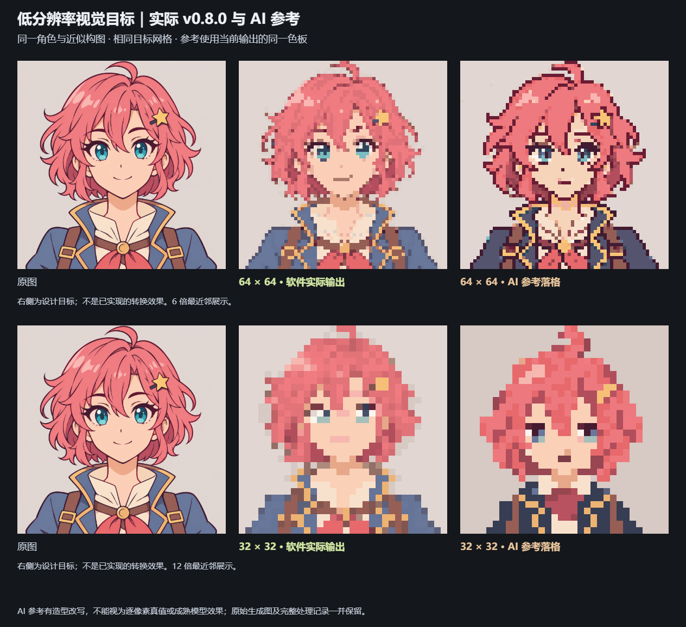
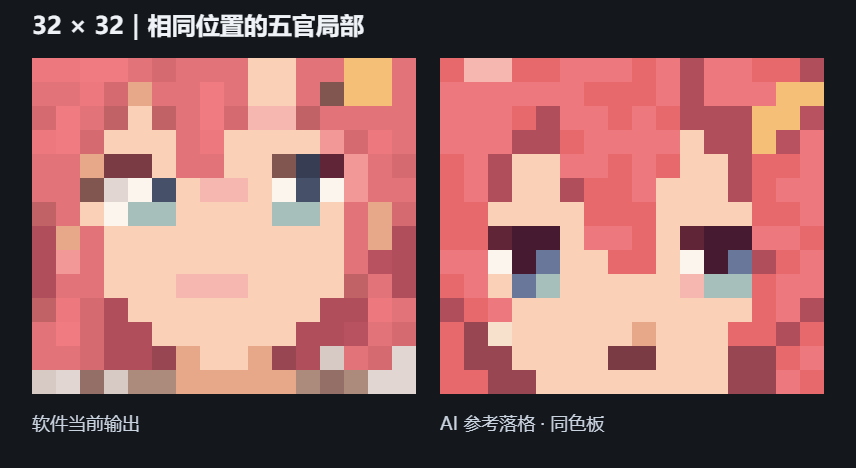
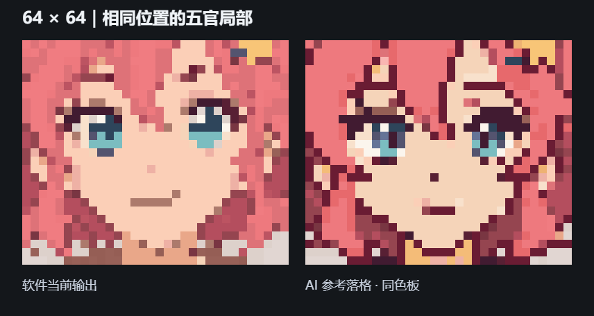

# 低分辨率转换的视觉目标与优化方向

日期：2026-11-06。当前软件：0.8.0，基线提交 `e4875960663dd3374677d36cd2d8ebc6161772c0`。

这是 0.9 升级前的视觉研究记录。后续实现和真实升级结果见[项目 README](../../README.md#低像素重构)与[0.9 流水线说明](../../docs/low-resolution-pipeline.md)；本页中的“当前”均指上述 0.8 基线。

## 对比图



左列为内置原图，中列为当前真实转换输出，右列为 AI 生成的视觉参考经目标网格与同色板规范化后的结果。上行为 64×64，下行为 32×32；分别使用 6 倍与 12 倍最近邻展示，不能把展示尺寸当成原生分辨率。

这组参考用于讨论视觉目标，本次没有修改转换算法，也没有集成生图模型。

## 比较方式与边界

- 原图：仓库内的 AI 插画示例 [public/illustration.png](../../public/illustration.png)。
- 中列：调用当前 `pixelateAccelerated`，使用真实 HRNet 五官辅助；CPU、结构保真、色块重构、描边保留 55、五官保真 75、细节补偿 75、自适应色板上限 32、不抖动。完整参数、实际模型执行信息及原生结果见 [current/manifest.json](current/manifest.json)。
- 右列：通过内置 imagegen 生成参考。生成器返回的是 1254×1254 的像素风图片，**没有严格输出原生的 32/64 网格**，因此保留原始生成图，另外通过最近邻采样得到真实 32×32/64×64，再调用软件的 Oklab 最近色量化器映射到各自基线的同一色板。没有再运行轮廓、细节补偿或其他结构修复。
- 64 px 基线实际使用 32 色，规范化参考使用其中 30 色；32 px 基线实际使用 31 色，参考使用其中 23 色。色数只用于确认比较条件，不代表质量评分。
- 第一轮 32 px 参考缩到真实网格后丢失了嘴线和虹膜，故又通过 imagegen 修改其网格参考，明确要求粗格眼睛、可见嘴线和简化衣领。首轮失败参考仍保留，以免只展示大尺寸的像素风图。
- AI 参考有造型改写：64 px 眉眼、嘴形和部分发束与原图不同；32 px 的头脸比例、发夹和服饰进一步简化。它们不是无损保真结果，不能直接作为配对训练真值，也不能证明当前已有模型能稳定完成任意原图转换。
- 尤其不能把 AI 参考中较粗的深色轮廓当作全局默认要求。应该借鉴其结构对比和色块组织，描边强弱继续可配置。

原始图、规范化方法、尺寸、色板、文件 SHA-256 见 [reference-manifest.json](reference-manifest.json)。生成提示词见 [prompts.md](prompts.md)。

## 主要差距与处理优先级

| 优先级 | 当前实际表现 | 视觉目标 | 应调整的算法决策 |
| --- | --- | --- | --- |
| P0 | 32 px 的嘴线接近肤色矩形，64 px 的眼睑、虹膜与高光层次较弱 | 少量像素也能表达眼睛与闭口表情 | 五官区域独立安排占格、邻接关系与对比度；关键点定位之后还需要局部离散重建 |
| P0 | 刘海、侧发和后发的区分减弱，发丝高光与阴影仍较零碎 | 少量连续发束，各自具有清楚的重叠关系 | 在区域归属前区分主体色块和结构线，再按目标尺寸合并低价值内部结构 |
| P1 | 头发与背景接触处出现浅色混合块，轮廓显得发虚 | 边界有明确颜色归属，必要阶梯连贯 | 边界覆盖率与前景/背景类别参与颜色选择，抑制来源于混色平均的浅边；避免对透明边缘统一扩张 |
| P1 | 衣领、金边、肩带、领巾占格较平均，低分辨率下容易互相打断 | 优先表达衣领与领巾关系，肩带与金边成为次级形状 | 为语义区域分配像素与色彩预算，允许合并扣具等次要细节 |
| P1 | “描边保留”是一项全局强度，拉高后会带回碎线，拉低后关键结构也变弱 | 眼睑、发束分界、外轮廓按各自作用保留 | 将轮廓强度与内部结构对比区分处理，使用局部结构置信度调节，保留用户可配置的整体风格强度 |

### 五官应优化局部图形，而非只补一个高光点





当前神经网络给出的是 28 个五官关键点。`semantic-runtime.ts` 并不预测最终眼睛、嘴巴的像素图形；`reconstruction.ts` 主要在关键点框内保护暗线、补高光并重采样嘴线。因此“识别到人脸”并不意味着已经学会低像素的画法。

近期可先验证：在有原图证据的五官 ROI 内生成多个网格相位与宽度候选，联合评价眼睑、眼白、虹膜的邻接关系、两眼相对位置和源图局部对比，择优输出。嘴线需要受源图支持、保持闭口/张口类别，并检查实际输出是否仍可见；不应把所有人的嘴替换成同一个微笑模板。允许有限位置调整与最小笔画表达，而不是对每个特征逐点机械取整。

### 合并发束时保留遮挡关系

现在的区域重构主要受颜色误差、空间位置及邻域平滑驱动，尚未理解一个深色边界是在区分“刘海盖住额头”，还是普通的发丝纹理。降低窄暗脊对比之后，两类线都会受到影响。

下一步应增加区域类别/结构置信度：保留刘海与脸、前发与后发、衣领与领巾之间的主要边界，在同一发束内部删除小阴影与短碎线。可以先做受源图支持的区域图与局部候选实验，再引入学习式区域预测，不能仅用增强全图锐化或提高描边参数代替。

现有 [描边强度对比](../../docs/images/outline-retention-comparison.png) 是必要对照：100 能恢复更多暗色，但同时引入碎线和杂点。新方案至少应在这项对照下展示其改善，而不是只与默认 55 比较。

## 神经网络升级方向

适合本项目的研究目标是“有结构约束的图像到像素重绘”：输入原图、目标尺寸、色板与风格强度，输出目标网格上的色板索引。这样最终仍是每格一种纯色，颜色数量与 MC/网格使用需求可严格约束。

建议分成两层验证：

1. **源图结构与语义预测**：人物/背景、脸/头发/服饰、主要遮挡线和五官区域，为重要结构提供证据。
2. **目标网格的离散重建**：学习在 32、48、64 px 的格数限制下，哪些结构应保持、合并或用更短的像素图形表达。目标直接针对原生小图，不能先生成大尺寸像素风图再假定缩小仍然正确。

HRNet 可继续负责定位，但其预训练任务不是像素绘制，单独更换更大的人脸关键点模型不能补齐第二层。完整学习式重绘需要合适的数据、训练和验证，本次生图参考不能代替这些工作。

训练/评估数据需要保留角色、姿态、表情、服饰与原生像素尺寸的对应关系；AI 生成参考可作为候选，需人工检查并修正造型漂移。学习目标应覆盖身份/结构、五官可读性、像素簇与色板约束，不能只最小化与缩小原图的逐像素误差；连通性等离散性质应做专门验收或使用明确的可微近似。

## 后续实验的验收要求

- 分别检查原生 32/48/64 px 和最近邻放大图，不能只展示大图。
- 使用固定原图和固定参数表，比较当前默认、描边 100、候选算法；另展示固定色板条件。
- 检查五官可读性、发束连贯、前景/背景边界和衣物关系；不以减少色数或减少孤立像素这一单项指标代替审美判断。
- 测试正脸、侧脸、遮挡、卡通动物与复杂场景；当前仅有一张正面插画的视觉实验，不能据此宣称泛化改善。
- 任意低分辨率改动都应保留 160 px 以上路径的回归对照。

## 文件与复现

| 文件 | 内容 |
| --- | --- |
| `current/baseline-32.png`、`baseline-64.png` | 软件当前原生输出 |
| `ai-reference-32-v2-raw.png`、`ai-reference-64-raw.png` | 选用的原始 AI 参考 |
| `ai-reference-32-grid.png`、`ai-reference-64-grid.png` | 真正目标网格与同色板参考 |
| `comparison.png` | 完整三列对比 |
| `face-32-comparison.png`、`face-64-comparison.png` | 相同坐标区域的五官放大 |
| `comparison-first-attempt.png` | 首轮 32 px 参考失败的对照记录 |
| `generate-comparison.mjs` | 仅做参考规范化、校验及对比排版的脚本 |

```powershell
node scripts/compare-low-resolution.mjs --output .cache/low-resolution-current
node design/low-resolution-targets-2026-11-06/generate-comparison.mjs
```

第一条重新运行当前版本，写入独立缓存目录，不覆盖本页保留的 0.8 基线。第二条根据已保存的 0.8 基线与生成图重新导出本研究的比较图，不会再次调用生图服务。两者均使用项目现有的 Playwright / Microsoft Edge 环境。
