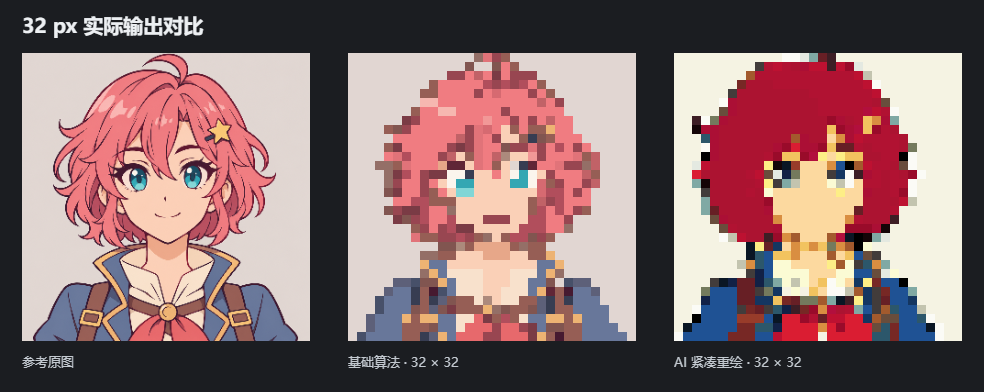
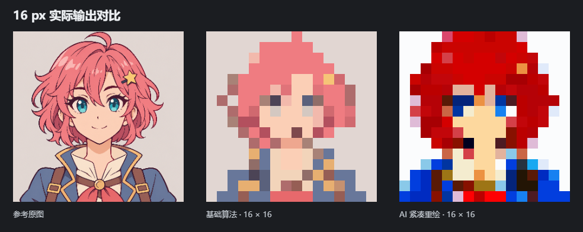

# 本地生成式重绘

生成式重绘是面向极低分辨率的独立实验路径。它使用原图条件图像编辑模型，允许重新组织发束、五官和色块，随后将候选约束到真实的小网格和色板。原有算法仍可独立使用；模型生成的结果需要人工比较后应用。

## 使用流程

1. 导入原图，点击 **AI 辅助重绘**。
2. 选择紧凑或大图重绘、目标长边（16、24、32、48、64 px）和颜色上限，可补充需要保留的特征。
3. 点击 **生成候选**。只有此操作会向本机服务提交图片；调整普通算法参数不会启动生图。
4. 比较原图、同尺寸算法结果、候选真实网格。可生成多个候选，并微调横纵取样偏移，检查五官是否在落格时丢失。
5. 使用选中的候选，或导出原尺寸 PNG。生成原图和参数 JSON 可以单独保存。原图始终保留，主界面可随时返回算法结果；修改主界面参数也会恢复算法路径。

候选最多在内存保留四张，关闭面板后释放。ComfyUI 会将参考图片与生成结果保存在自己的 `input` / `output` 目录；关闭应用不会删除这些文件。**停止等待**移除当前尚未执行的任务，不全局中断服务中的运行任务。

## 模型与硬件

默认后端为本机 ComfyUI 的 FLUX.2 Klein 4B 图像编辑工作流，仅使用核心节点。

| 组件 | 配置 |
| --- | --- |
| 扩散模型 | `flux-2-klein-4b-fp8.safetensors`，约 4.07 GB |
| 文本编码器 | `qwen_3_4b.safetensors`，约 8.04 GB，在 CPU 上运行 |
| VAE | `flux2-vae.safetensors`，约 0.34 GB，在 CPU 上运行 |
| 采样 | Euler，4 步，CFG 1，单图 |
| 原图参考 | 长边 512，独立于生成尺寸，透明区域合成白底 |
| 紧凑生成 | 目标长边的约 4 倍，通常为 64–256；如 32 px 生成 128 × 128，长宽为 16 的倍数且短边至少 64 |
| 大图生成 | 长边 512，短边至少 128，保留更多细节，但落格可能更碎 |
| 宽高比 | 原图支持 1:4 至 4:1；生成尺寸对齐到 16 的倍数，最终网格按原图比例确定 |
| 显存策略 | ComfyUI `--lowvram`，将部分权重卸载到系统内存 |

权重合计约 12.45 GB；首次安装还需要 CUDA PyTorch、Python 环境和 ComfyUI 的空间。推荐至少 32 GB 系统内存并预留 25 GB 磁盘。8 GB 显卡需要卸载；官方完整精度模型约需 13 GB 显存，不能将其原生显存要求与本项目的 FP8 + CPU 卸载配置混为一谈。实际耗时取决于 CPU、内存、显卡和其他程序的占用。

## 安装与启动（Windows）

需要 NVIDIA 显卡、兼容驱动和 Python 3.10–3.13。安装脚本建立独立虚拟环境，不修改系统 Python 包。

在项目目录中执行：

```powershell
powershell -File scripts/setup-generation.ps1
powershell -File scripts/start-generation.ps1
```

也可先双击 `scripts/setup-generation.cmd` 完成安装，再双击 `scripts/start-generation.cmd` 启动服务。启动窗口会显示模型执行日志，关闭该窗口可结束本次生成服务。

如果 `python` 不对应受支持的版本，可以显式传入路径：

```powershell
powershell -File scripts/setup-generation.ps1 -PythonExe "C:\Python313\python.exe"
```

默认运行文件位于项目的 `.cache/generation`，不会进入 Git。可通过两个脚本的 `-RuntimePath` 参数指定其他目录，安装与启动时使用同一目录。大文件下载支持续传，并按固定 SHA-256 校验；校验不符不会覆盖已有模型。

服务固定监听 `127.0.0.1:8188`。启动后保持该进程运行，再打开桌面应用。常规像素转换无需此服务。已经安装 ComfyUI 的用户可以使用自己的服务：将清单中的三个文件放在相应 `models/diffusion_models`、`models/text_encoders`、`models/vae` 目录，保持相同文件名，并使用支持 Klein / ReferenceLatent / Flux2Scheduler 的版本。本项目不会远程安装自定义节点。

主界面的“计算设备”控制原有图像处理流水线；生成模型的设备由 ComfyUI 启动参数决定。应用候选后，状态栏显示本地 AI 及包含排队、模型加载的候选等待时间，不将网格整理的毫秒数作为模型推理耗时。

运行库版本、下载地址、大小及校验值见 [固定模型清单](../scripts/generation-models.json)。默认 ComfyUI 源码固定到 `2c75dc1b379a59e0880619d029607af5169a62ef`（v0.44.0）；安装后生成 `installed-requirements.txt` 记录实际依赖。

## 处理方法

令原图参考为 $I$，目标网格为 $W\times H$，编辑指令为 $p$，随机种子对应噪声为 $z_s$，生成尺寸为 $R=(W_J,H_J)$。生成阶段为：

$$
J_s=G_{\theta}(I,p(W,H,K),z_s;R).
$$

参考原图经 VAE 编码，通过 `ReferenceLatent` 注入条件。模型从空潜变量开始重新生成，并非将旧算法结果作为最终图像。文本指令要求保留角色、姿态与主要配色，减少在小尺寸下拥挤的粗黑线，并重新安排五官与发束。

模型产生的是较大尺寸的候选 $J$，不会可靠地严格遵守真实像素格。网格阶段使用可调相位 $\delta_x,\delta_y\in[-0.45,0.45]$：

$$
C_{xy}=J\!\left(\left\lfloor(x+\tfrac12+\delta_x)\frac{W_J}{W}\right\rfloor,
\left\lfloor(y+\tfrac12+\delta_y)\frac{H_J}{H}\right\rfloor\right).
$$

再使用现有 Oklab 色板量化：

$$
O_{xy}=\arg\min_{c\in P_K}\|\operatorname{Oklab}(C_{xy})-\operatorname{Oklab}(c)\|_2^2.
$$

此阶段不重新添加原图轮廓、不执行线稿保护或细节锐化、不使用抖动。自适应色板不超过设定色数，固定色板仅使用其已有颜色。原尺寸导出为真实 $W\times H$ PNG，放大预览使用最近邻。

**这仍不是训练在原生小网格上的像素画生成器。** 当模型给出的结构在落格后不成立时，相位调整无法凭空补回信息，应该更换候选或重新生成。16–32 px 也无法完整保留高分辨率细节；模型可能改变角色特征、服装、比例或表情。透明输入先合成白底，不承诺还原透明背景。

## 实测与当前限制

实测设备为 RTX 4060 Laptop 8 GB、32 GB 系统内存，使用清单中的 FP8 模型、CPU 文本编码器与 CPU VAE。通过真实 ComfyUI 推理和应用界面完成生成、候选比较、32 × 32 原尺寸导出、取样偏移与应用检查；未将模拟接口作为生成质量验证。





16 px 测试使用 64 × 64 的实际生成输出，蓝色眼睛等色彩记号仍可辨认；神态、发色与嘴线仍存在偏差。[16 px 提示与参数](redraw-example-16.json) 单独记录本次请求。

示例使用内置 AI 插画，种子 314159、紧凑 128 × 128 生成、32 色、零取样偏移。此轮界面记录的等待时间约 24.5 秒，包含排队与已加载模型状态下的执行，不能作为所有硬件或冷启动的速度保证。输出与提示见 [参数记录](redraw-example.json)。生成结果的发色发生偏移，嘴线也未稳定保留；目前只将其作为供用户比较选择的辅助路径，不宣称已经解决极低分辨率质量问题。

开发中同时检查过 512 大图生成、双参考图、64/128/256 生成尺寸，以及公开的像素画风格 LoRA。通用模型与该风格 LoRA 在此样本上仍容易保留过细线条；双参考图也没有稳定保住嘴部，因此未将它们作为默认质量提升方案。更小生成尺寸能降低细节密度，但可能损失神态。进一步提升需要针对原生小网格、关键特征占格和角色保真作专门评估，不能仅凭模型名称或大图的像素风外观判断。

对照研究：[像素画 LoRA 模型卡](https://huggingface.co/Limbicnation/pixel-art-lora)、[SD-πXL 论文与代码](https://github.com/AlexandreBinninger/SD-piXL)。本版本未集成这些额外权重或优化流程。

## 来源

- [FLUX.2 Klein 4B 官方模型卡](https://huggingface.co/black-forest-labs/FLUX.2-klein-4B)：图像编辑能力与 Apache-2.0 权重声明。
- [官方 FP8 权重](https://huggingface.co/black-forest-labs/FLUX.2-klein-4b-fp8)。
- [ComfyUI Klein 图像编辑教程](https://docs.comfy.org/tutorials/flux/flux-2-klein)。
- [ComfyUI 官方工作流模板](https://github.com/Comfy-Org/workflow_templates/blob/main/templates/image_flux2_klein_image_edit_4b_distilled.json)：参考条件、Flux2Scheduler 与 CFG 配置。
- [ComfyUI 服务 API](https://docs.comfy.org/development/comfyui-server/comms_routes)：上传、队列、历史与输出图片。

各组件许可与完整条款以相应上游仓库为准；运行环境和模型权重不随桌面安装包分发。
