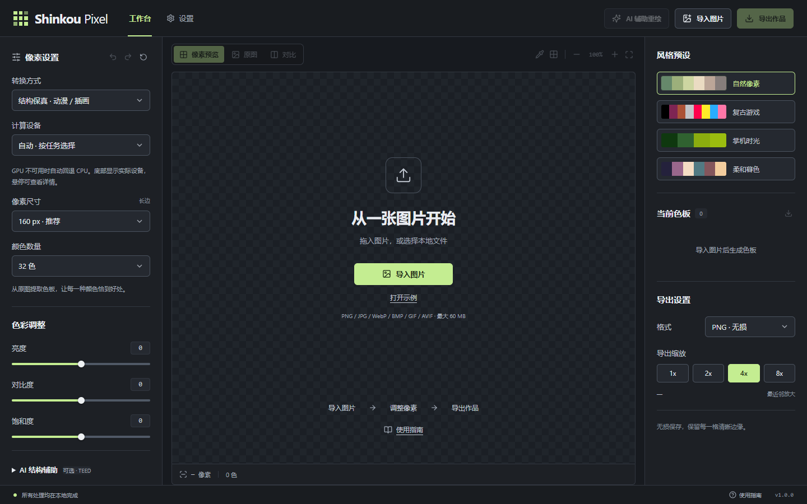
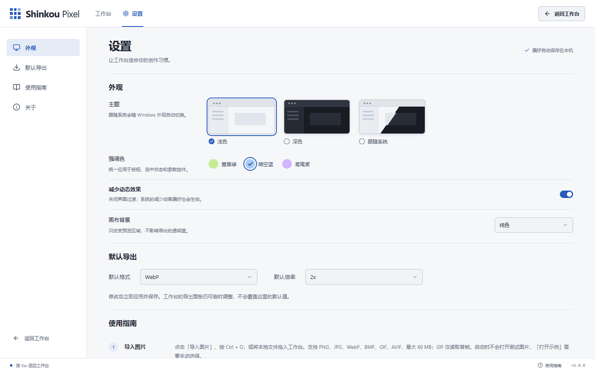

# Shinkou Pixel 1.0.0

1.0.0 带来更清晰的空白工作台、独立设置页和完整主题系统。保留原有的结构保真、照片采样、低像素重构与可选本地 AI 辅助重绘。

## 界面与操作

- 启动时不再自动打开或处理测试图片。导入自己的图片后开始创作，示例仅在点击「打开示例」时加载。
- 新增应用内「设置」，支持浅色、深色、跟随系统，以及萤草绿、晴空蓝、鸢尾紫三种强调色；Windows 原生窗口也同步深浅主题。
- 新增棋盘格 / 纯色画布、减少动态效果与导出默认格式 / 倍率。偏好保存在本机，重启后恢复；切换设置会保留当前图片和转换参数。
- 优化工作台间距、字号、预设空态、禁用反馈和窄屏布局。常用色彩调整前置，可选 AI 线条辅助默认折叠；移除图片后可回到空白工作台。
- 应用内使用指南和配套文档补充导入、预览对比、真实像素与整数倍导出、快捷键，以及不同 AI 功能的环境要求。
- 空白启动不创建图像处理 Worker；移除图片时释放处理线程及旧预览。

## 下载与使用

| 附件 | 用途 |
| --- | --- |
| `ShinkouPixel-v1.0.0-windows-x64.exe` | Windows x64 独立可执行文件 |
| `ShinkouPixel-Setup-v1.0.0-windows-x64.exe` | Windows x64 安装程序 |
| `ShinkouPixel-AI-Tools-v1.0.0-windows.zip` | 可选 AI 重绘服务的安装 / 启动脚本与说明 |
| `SHA256SUMS.txt` | 发布附件的 SHA-256 校验值 |

普通像素转换和内置线条 / 五官辅助无需 Python、CUDA 或 ComfyUI。**AI 辅助重绘为可选实验功能**，需要独立安装本机服务与约 12.5 GB 模型，模型不包含在 EXE 或工具包中。生成结果可能改变角色特征，请比较候选后再应用。

从工作台点击「设置」，或按 `Ctrl + ,` 打开；按 `Esc` 返回。`Ctrl + O` 导入，`Ctrl + S` 导出，`Ctrl + Z` 撤销，`Ctrl + Shift + Z` 重做。

[完整使用指南](https://github.com/cuupe/Shinkou-img2pix/blob/v1.0.0/docs/user-guide.md) · [本地 AI 重绘安装与说明](https://github.com/cuupe/Shinkou-img2pix/blob/v1.0.0/docs/generative-redraw.md)

## 验证

- 14 个测试文件、84 项测试通过，前端生产构建和 Tauri Release / NSIS 构建通过。
- Microsoft Edge 下验证空白启动、主题切换和持久化、系统主题变化、导入 / 对比 / 撤销 / 导出、移除图片及手动示例。
- 检查 1440×900 桌面、390×844 窄屏及设计稿原始尺寸。验证本地存储损坏 / 不可用时的恢复与提示。
- 最终 Windows EXE 验证原生主题同步、空白工作台与打包示例转换。大型模型生成和安装向导未在本轮重跑。
